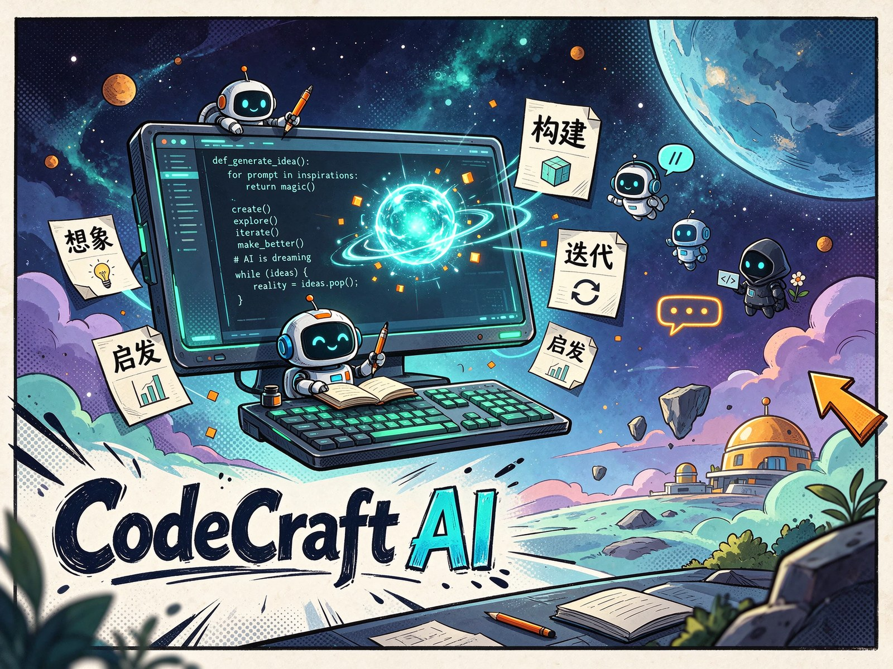

<p align="center"></p>

<h1 align="center">CodeCraft AI</h1>

<p align="center">玻璃拟态 + 粒子背景的 AI 产品展示页</p>

<p align="center">
  <a href="http://codecraft.aikex.ink/">在线查看</a>
</p>

## 简介

一个用于展示 AI 编程助手的产品落地页：首屏粒子动效、玻璃拟态卡片、滚动渐入的分段介绍。结构简单，改文案和配色就能复用到别的产品。

## 功能

- **粒子首屏**：Canvas 粒子随页面滚动散聚
- **玻璃拟态卡片**：半透明模糊材质承载功能条目
- **滚动动效**：分段内容进入视口时渐入
- **响应式布局**：桌面、平板、手机三档断点
- **纯静态**：单页 HTML，无需构建

## 技术栈

HTML5 · CSS3（backdrop-filter、CSS Grid）· 原生 JavaScript（Canvas 粒子）

## 快速开始

直接用浏览器打开 `index.html`，或静态托管：

```bash
python -m http.server 8080
```

## 项目结构

```
index.html    页面结构
css/          玻璃拟态与动效样式
js/           粒子与滚动交互
```

## 许可证

仓库未附 LICENSE 文件，使用与分发请先联系作者确认。
